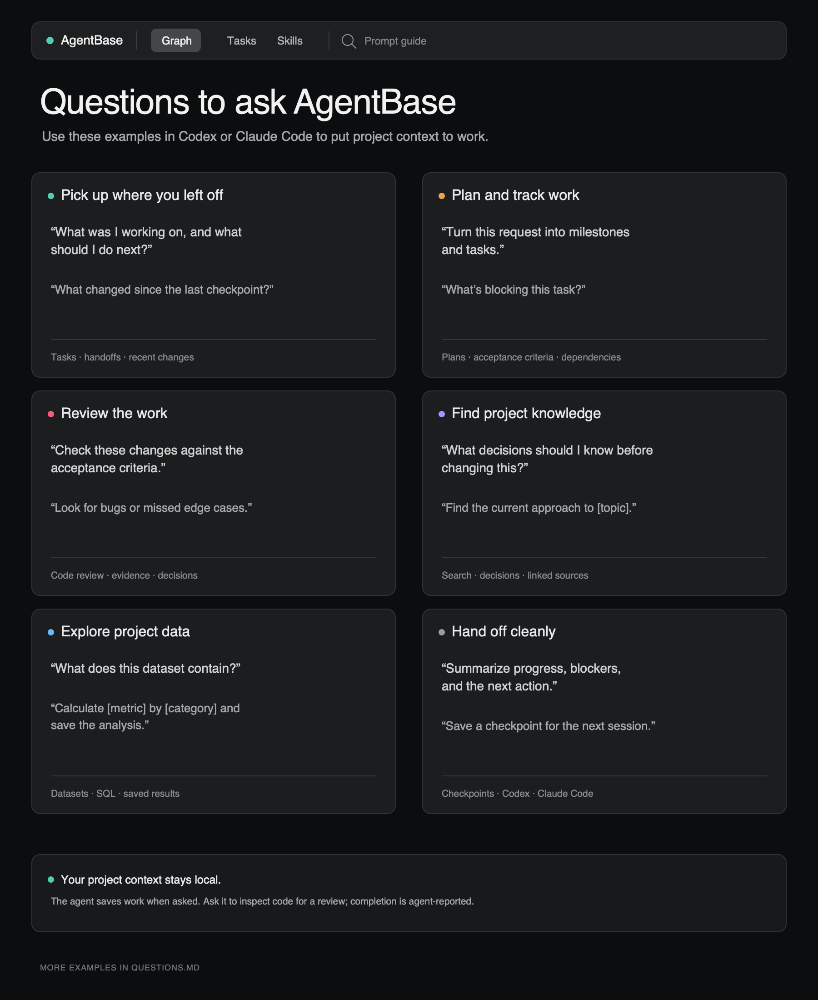

# Questions to ask AgentBase

Ask these in Codex or Claude Code with AgentBase connected to your project. The agent can use AgentBase’s saved project context, tasks, knowledge, plans, skills, and datasets to answer or take the requested action.

## Pick up where you left off

- What was I working on in this project, and what should I do next?
- Which tasks are open, blocked, waiting on someone, or ready to start?
- What changed in this project since the last checkpoint?
- Find the handoff for the unfinished task and summarize the next steps.
- Have we solved a similar problem before? Find the relevant work and explain what we learned.
- What decisions should I know before changing this part of the codebase?

## Understand project knowledge

- Search our saved knowledge for the current approach to **[topic]**.
- What do we know about **[system or feature]**, and what are the sources?
- Show me the concepts and tasks connected to **[record or topic]**.
- Are there conflicting, stale, or uncertain notes about **[topic]**?
- Compare these two saved decisions. Which one is current, and why?
- Save this finding as sourced project knowledge and link it to the task I’m working on.

## Plan and track work

- Turn this request into a plan with milestones, acceptance criteria, assumptions, and open questions.
- Break this feature into tasks and show which tasks depend on each other.
- Is there already an open task for **[work]**? If so, update it instead of creating a duplicate.
- Claim the next ready task and tell me its acceptance criteria.
- What is blocking **[task]**, and what needs to happen before it can move forward?
- Update this task with the progress and evidence from the work we just completed.
- Mark this task ready for review and summarize what changed and how it was checked.
- Complete this task with a summary and concrete evidence of the work.

## Review work and decisions

- Review the completed work against the task’s acceptance criteria. What is covered, and what still needs checking?
- Inspect the changed files for bugs or missed edge cases, and report findings with file references.
- Review this implementation plan for missing steps, risks, and unclear requirements.
- Review the pending memory notes. Which are well sourced, and which should be corrected or rejected?
- Find possible duplicate or contradictory memories about **[topic]** and help me review them.
- What evidence supports marking this task complete?

## Use project skills

- Which registered project skills apply to **[task]**, and why?
- Find the skill for **[workflow]** and show me its source.
- Does this project have guidance for testing, releasing, or investigating **[area]**?

## Explore project data

- What datasets are registered for this project, and what does each contain?
- Inspect **[dataset]** and summarize its columns, size, and a few sample rows.
- Using **[dataset]**, calculate **[metric]** by **[category or date]**.
- Compare **[measure]** across **[groups or time periods]** and save the analysis.
- Check **[dataset]** for missing values, duplicate keys, or unexpected ranges.
- Explain this saved query and the data it used.

## Keep project state safe

- Is AgentBase connected to the right project and data store?
- Create a backup of this project, then verify that the backup is readable.
- What does the project export include, and which dataset files are stored with a backup?

## Ask for a useful handoff

- Save a checkpoint with what we finished, what remains, and the next action.
- Prepare a handoff so another Codex or Claude Code session can continue this work.
- Summarize the current state of **[task]**, including decisions, links, blockers, and verification evidence.

AgentBase records information when the agent explicitly saves it. It does not silently capture every chat, inspect every repository change automatically, or independently certify an agent’s completion report. For code review, ask the agent to inspect the relevant changes and report its findings.
