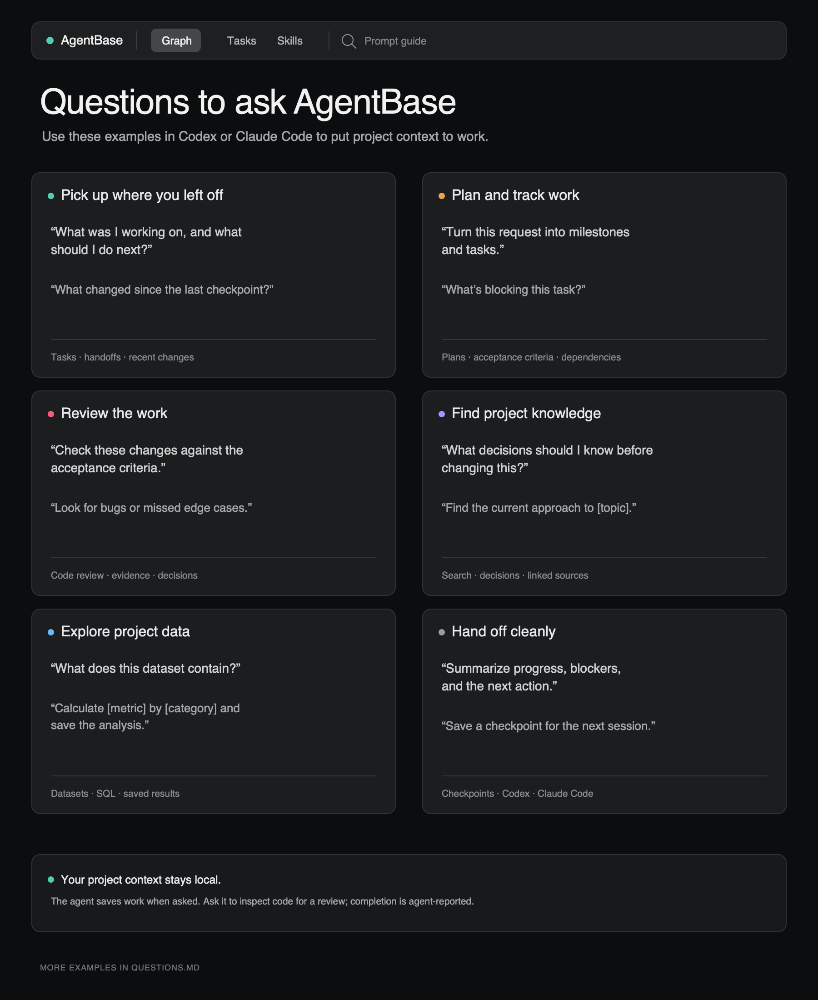

# AgentBase

**Open-source, local project memory for coding agents.** AgentBase keeps tasks, decisions, sources, and handoffs in a project database. Codex and Claude Code access it through MCP; the desktop app shows the graph, task board, and skills.


## What can you ask?



See [more example questions](Questions.md).

## Download

| Platform | Bundle |
| --- | --- |
| Windows 10/11 (x64) | [Download AgentBase for Windows](https://github.com/SeanPreusse/agentbase/releases/latest/download/AgentBase-0.7.6-windows-x64.zip) |
| macOS 14+ (Apple silicon) | [Download Mac installer](https://github.com/SeanPreusse/agentbase/releases/latest/download/AgentBase-0.7.6-macos-arm64.pkg) · [App ZIP](https://github.com/SeanPreusse/agentbase/releases/latest/download/AgentBase-0.7.6-macos-arm64.zip) |

The bundles include Node.js and the AgentBase runtime. On Windows, extract the ZIP and run `AgentBase.exe`. The Mac package installs `AgentBase.app` in Applications. These direct downloads are not yet Microsoft Store signed or Apple notarized; your operating system may ask you to approve opening them. See the [release page](https://github.com/SeanPreusse/agentbase/releases/latest) for all assets.

## Connect a coding agent

Requires Node.js 22.22+ and Codex or Claude Code:

```sh
git clone https://github.com/SeanPreusse/agentbase.git
cd agentbase
npm ci
npm run plugin:up
```

Start a new Codex session after installation. In the app, use **Connections** to inspect the local data folder. Codex and Claude Code share projects when both MCP servers use that folder (default: `~/.local/share/agentbase`). Ask your agent to resume the current workspace, track a task, or save a sourced decision.

## What it does

- Keeps project knowledge, plans, tasks, and handoffs locally, with search and linked context.
- Runs sandboxed SQL on imported CSV, JSON, JSONL, and Parquet data; saved results retain their query and provenance.
- Backs up project records and imported data together.
- Lets you review, correct, supersede, or forget saved memory from the graph.

AgentBase does not run a hosted project-data service or silently collect conversations. Its optional **Your AI** feature sends only the material you choose to your configured AI provider when you press **Judge**. See [Privacy](PRIVACY.md).

## Develop

Run `npm ci`, `npm test`, and `npm run test:ui` for macOS Inspector changes. Contributions are welcome through issues and pull requests. Licensed under [Apache-2.0](LICENSE).
